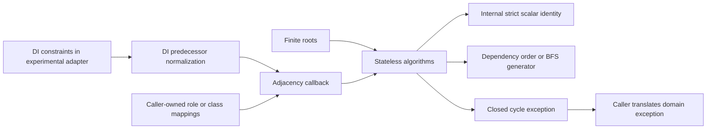

# Proposal: a standalone Graph component

Status: local exploration for the 8.2 development line; production DI and Security use private optimizations after performance evaluation. This directory is not an official Symfony RFC submission location.
Repository baseline: `e63156feff4fe23338afb374be62026a286149d1`, working branch `form-guess-entity-exists-field`.

## Summary

Explore storage-independent directed graph operations over scalar node identifiers, with deterministic dependency ordering and breadth-first reachability as the initial scope. A working Graph/DI adaptation is retained in the benchmark fixtures. After comparing it with a private iterative DI rewrite, the production DI change uses the private rewrite and does not require Graph. A subsequent role-hierarchy experiment selected a smaller internal visited-hash improvement in Security, also without a Graph dependency. The component remains an experimental local foundation; a new official package needs a convincing additional consumer and maintenance case. This result is a reassessment of the initial migration, not a universal performance claim.

## Motivation

BeforeAfterSorter implements recursive DFS postorder, active-path cycle detection and finished-node tracking. Security RoleHierarchy computes transitive reachability with a separate visited list and expanding array queue. Serializer AbstractObjectNormalizer walks nested discriminator class mappings with another visited map and queue. These are real graph operations, unlike most recursive normalization and configuration processing. The common need is algorithm state, not a common graph object. A small standalone package can keep that state correct and testable while leaving domain semantics with callers.

## Current State

The investigation used the initial local checkout at the recorded baseline, not an assumed upstream release. This inventory describes that baseline; the evaluation sections document the final working-tree changes. Searches covered circular references, visited sets, successor/predecessor processing, DFS/BFS terminology, topological ordering, queues, alias chains and recursive relationship processing. No existing general strongly connected component implementation was found by these searches. Complexity estimates below come from source inspection, not timing; let V and E denote the relevant reachable graph, D depth, L chain length and R the number of roots. Hash membership assumes average constant time and excludes identifier byte lengths, metadata and callback costs.

### Algorithms and extraction candidates

All source paths below are relative to the monorepo root. Each assessment covers purpose, representation, complexity, duplication, performance, compatibility and whether extraction simplifies the caller.

| Component and exact source | Algorithm and purpose | Representation and existing cost | Reuse, performance and compatibility assessment |
|---|---|---|---|
| `DependencyInjection/Compiler/BeforeAfterSorter.php`, under `src/Symfony/Component/` | DFS postorder over predecessors; reject cycles while ordering before/after constraints. | Adjacency arrays, states map, recursive calls, copied path list. O(E + sum of first-visit depths) time; a chain has O(V²) path copying and O(D²) live path storage. | Strong prototype: domain normalization remains local, recursive algorithm disappears. Exact seed order, aliases, custom constraint names, self/unknown-item filtering, priority errors and cycle messages must survive. Iterative traversal fixes the path-copy cost; abstraction adds measurable dispatch/identity/iterator overhead. |
| `src/Symfony/Component/DependencyInjection/Compiler/CheckCircularReferencesPass.php` | Service reference cycle checking with deferred lazy nodes. | `ServiceReferenceGraph`, node/edge objects, mutable path, two checked maps; `array_search` per active concrete edge. O(E·D + R), excluding graph construction, for membership scans on qualifying edges; lazy-state behavior complicates a simple graph bound. | Common DFS state, but destination value truthiness, lazy/weak flags and deferred checked state are not generic cycle policy. Replacing with a callback that drops all lazy edges is insufficient. Preserve ServiceCircularReferenceException path/message and repeated-pass behavior. Defer extraction: substantial characterization needed. |
| `src/Symfony/Component/DependencyInjection/Compiler/RemoveUnusedDefinitionsPass.php` | Reachability from public definitions and public aliases, then remove unreachable services. | Batched frontier arrays and connected-ID hash; `AbstractRecursivePass` discovers references inside definitions. O(V+E) graph bookkeeping plus value scans and removal work. | Credible later traversal use, but reference invalid-behavior filtering, expressions, environment placeholder handling and cleanup stay in DI. Already avoids repeated expansion; expected benefit is shared state, not established speed. An adapter must not rescan definitions twice. |
| `src/Symfony/Component/DependencyInjection/Compiler/DefinitionErrorExceptionPass.php` | Reverse reference traversal deciding whether definition errors can be deferred to runtime. | Source-reference maps with runtime flags, memoized boolean state and recursive optimistic cycle handling. O(V+E) memoized graph bookkeeping, plus definition scans. | Graph shape is present, but boolean edge policy and cycle interpretation differ from plain traversal. First error and runtime invalid-reference behavior are compatibility constraints. A generic visited iterator alone does not simplify this decision algorithm. |
| `src/Symfony/Component/DependencyInjection/Compiler/ResolveClassPass.php` | Detect cycles in child-definition parent chains before class resolution. | Parent-chain list and shared acyclic hash; `array_search` scans. O(L²) for a previously unseen chain, then cached prefixes. | Same chain pattern as Routing; callback sort could detect cycles but also creates an unnecessary full order. Missing parents, alias resolution, chosen cycle start and ServiceCircularReferenceException must remain. A private chain utility may be simpler. |
| `src/Symfony/Component/DependencyInjection/Compiler/CheckFactoryBuilderCircularReferencePass.php` | Search builder setup and eager constructor references for a path back to the produced service. | Nested arrays, Definition/Reference objects, visited-ID hash and active path; per-root graph traversal O(V+E), excluding nested value and alias scans. | Genuine reachability interleaved with structural scanning. Inlined definitions scan more fields than named references; lazy/synthetic nodes prune traversal. A plain adjacency adapter must reproduce these distinctions and diagnostic paths. Keep local for this iteration. |
| `src/Symfony/Component/DependencyInjection/Dumper/PhpDumper.php::collectCircularReferences()` | Collect constructor-sensitive loops to choose when generated services are shared. | Reference graph, copied associative path, checked map, loop records with references, constructor flags. Path copies and loop propagation/output can exceed O(V+E); output may be quadratic and no tight linear claim is justified. | Not interchangeable with first-cycle rejection or SCC membership. Generated code timing, self-references, expression references and lazy flags are observable. Extraction currently adds complexity. `collectLineage()` is a separate recursive class/reflection walk with export effects. |
| `src/Symfony/Component/Security/Core/Role/RoleHierarchy.php::buildRoleMap()` | Transitive reachable-role closure for each configured root, accepting cycles. | Adjacency arrays, pointer into appended queue, visited list, `array_diff`, result map. Repeated pending entries may expand repeatedly on convergent DAGs; work can follow path counts. Storing all root closures can require O(V²). | Strong next consumer for BFS with unique scheduling. However, the current map inserts children eagerly while expanding a role; a plain BFS result list changes insertion order. Preserve protected map/method behavior, role names, wildcard placeholder patterns and closure order. Shared traversal can remove queue/visited bookkeeping; actual speed is unmeasured. |
| `src/Symfony/Component/Serializer/Normalizer/AbstractObjectNormalizer.php::getAllowedAttributes()` | BFS over nested discriminator mappings to collect all allowed subtype attributes. | Class-name visited hash, `array_shift` and `array_merge` queue, attribute arrays. Graph visits O(V+E), but queue shifts/copies can add quadratic work in pending entries. | Strong next consumer: adjacency comes from the resolver without materializing another graph. Preserve BFS order, initial class exclusion, discriminator properties, string versus AttributeMetadata mode, parent attribute filtering and context. Replace only queue/visited logic; keep aggregation local. Callback overhead needs measurement. |
| `src/Symfony/Component/Routing/RouteCollection.php::get()` | Follow aliases, reject repeated names and emit deprecations in traversal order. | Alias map and visited-name list; O(L²) due to `array_search`, O(L) state. | Exact repeated chain-detection pattern with the compiled alias dumper. A local chain helper may beat a public graph abstraction. Preserve deprecation order and exception identifier/path, including numeric names and loose comparisons. |
| `src/Symfony/Component/Routing/Generator/Dumper/CompiledUrlGeneratorDumper.php::getCompiledAliases()` | Resolve every alias and collect deprecations before compiling its target route. | Alias map, per-alias visited list and accumulated deprecations. Worst O(A·L²) for A aliases, plus route compilation. | Shares chain detection with RouteCollection but starts at the alias target rather than requested alias. Missing targets and deprecation handling differ. No migration in this prototype. |

### Graph-shaped domain processing that should stay local

| Exact source | Purpose, structures and complexity | Why generic extraction does not currently simplify it |
|---|---|---|
| `src/Symfony/Component/Config/Loader/FileLoader.php::doImport()` | Dynamic import-cycle guard: static active-loading hash, loader dispatch and `finally` cleanup. Average O(1) membership per import, O(D) active state, excluding file/loader effects. | Discovery and execution are interleaved. Candidate resource selection, ignored errors, source exception wrapping and cleanup matter. Precomputing a graph changes behavior; existing guard is already efficient. |
| `src/Symfony/Component/DependencyInjection/ParameterBag/ParameterBag.php::resolveValue()` / `resolveString()` | Recursive placeholder substitution with active-key map, array traversal and regex callbacks. Membership is O(1); copied path maps can have depth-related cost, while substitutions may expand output and repeat work. | Escaping, string composition, types, resolved-state caching and error path are the operation. Extracting a visited set does not separate an independent graph algorithm. |
| `src/Symfony/Component/Serializer/Normalizer/AbstractNormalizer.php::isCircularReference()` | Object-ID occurrence counters in branch context with configurable repetition limits; average O(1) counter update. | A repeated object is not always a cycle. Global visitation would change limits, branch semantics and circular-reference handlers. |
| `src/Symfony/Component/Validator/Validator/RecursiveContextualValidator.php`; `src/Symfony/Component/Validator/Context/ExecutionContext.php` | Cascading object/property validation, nested collections and group sequences; SplObjectStorage identity and caches keyed by validation state. Cost depends on metadata, constraints and group states, not just V+E. | Early termination, getters, property paths and object/group/constraint caches are domain semantics. Simple node visitation is insufficient. |
| `src/Symfony/Component/Workflow/Workflow.php`; `Definition.php`; `Validator/WorkflowValidator.php`; `Validator/StateMachineValidator.php` | Weighted Petri-net marking and transition semantics; definition validators scan arcs and uniqueness tables. Arc scans are linear in input arcs except repeated name-list membership, which can be quadratic per place. | No current general DFS/BFS/cycle/SCC algorithm was found here. Multi-input transitions and weights cannot be reduced to simple place adjacency for execution. Structural reachability could be future functionality, not an existing extraction justification. |
| `src/Symfony/Component/Scheduler/Generator/MessageGenerator.php`; `Generator/TriggerHeap.php` | Scheduling by trigger time, O(log M) heap extraction/reinsertion for M pending messages. | A priority queue is not itself a graph traversal. |
| `src/Symfony/Component/EventDispatcher/EventDispatcher.php` | Sort listener priority buckets and invoke listeners, O(P log P + listeners); debug identity tracking in the debug dispatcher. | Priority order and SplObjectStorage usage do not establish a dependency graph. |
| `src/Symfony/Component/VarDumper/Cloner/VarCloner.php::doClone()`; `Cloner/Data.php` | Genuine breadth-first value-graph cloning and depth-first dumping, using array-reference IDs, object/resource handles, stubs and budgets. Visitation cost is proportional to expanded values plus caster/output work. | The BFS queue is also the output representation. Identity preservation, hard references, caster effects and cut budgets require specialized state. Introducing another visited map or queue would duplicate work and likely add overhead. |
| `src/Symfony/Component/Console/Helper/TreeHelper.php::render()` | RecursiveTreeIterator rendering with SplObjectStorage to reject repeated objects, O(visited nodes) traversal plus rendered output. | Rejects shared DAG nodes as well as cycles. A conventional cycle detector has different behavior. |
| `src/Symfony/Component/Tui/Widget/AbstractWidget.php::findById()` | Recursive tree search, O(visited widgets), O(D) call depth, stops at first match. | Widget containment is a tree; parent/type invariants and direct object return make scalar graph adaptation unnecessary. |
| `src/Symfony/Component/Translation/MessageCatalogue.php::addFallbackCatalogue()` | Walk fallback/parent locale chains and propagate resources; linear chain scans plus resource-copy cost. | Locale equality and side effects are local domain rules. Existing check is small and linear. |
| `src/Symfony/Component/AssetMapper/Factory/MappedAssetFactory.php::createMappedAsset()` | Dynamic creation stack and completed-asset cache during compilation, average O(1) identity checks, O(D) active state. | Partial assets, compiler effects, cache lifecycle and `finally` cleanup matter. Generic offline traversal does not match this process. |

Other effectful recursion guards in `src/Symfony/Component/OptionsResolver/OptionsResolver.php`, `src/Symfony/Component/Form/FormRegistry.php`, `src/Symfony/Component/Yaml/Parser.php` and `src/Symfony/Contracts/Service/ServiceLocatorTrait.php` do not justify migration merely because they track an active resolution path.

The strongest consumers are therefore DI dependency ordering, Serializer discriminator BFS and Security role closure. This is sufficient to initiate a storage-independent prototype, but not sufficient on its own to establish the maintenance case for a new official package.

## Goals

* Reuse algorithms without copying graph storage.
* Preserve deterministic input order and cycle diagnostics.
* Bound time by reachable nodes and edges, excluding user adjacency costs.
* Avoid recursive PHP calls on deep graphs.
* Work without FrameworkBundle or third-party packages.

## Non-Goals

Graph editing, visualization, weighted shortest paths, distributed execution, persistent collections, generic visitors, object equality, dependency-container semantics and Petri-net execution are outside the first iteration. Not every recursive operation is a graph traversal. Strongly connected components, undirected graphs and predecessor indexing require a concrete consumer before inclusion.

## Alternatives Considered

Keeping the existing implementations has the lowest package and public-API cost, but retains independent graph state and the measured deep path-copy cost. A private iterative DI utility can fix that performance issue without a new public API; it is the strongest alternative and must be compared fairly. Sharing an internal utility across components avoids public commitments but still introduces cross-package coupling, or duplicates code when components are installed separately. A standalone component makes that dependency explicit and reusable outside Symfony, at the price of a new long-lived package/API. Third-party graph libraries have useful breadth, but the examined APIs require richer storage than these consumers need and add dependencies/conversion work.

The selected standalone experiment is justified by DI ordering plus two independent reachable-subgraph consumers. It is not a claim that an official package is automatically preferable. If representative workloads or maintainer feedback reject the maintenance cost, retain the private iterative fix and close the public-component proposal.


1. `GraphInterface::getNodes()` and `getSuccessors(mixed $node)`: discoverable, but forces enumeration, adapters and identity decisions even for an implicit reachable subgraph.
2. Algorithm functions accepting roots and adjacency callbacks: fit existing arrays and domain objects; no mandatory storage or service wiring. Static methods follow the existing BeforeAfterSorter convention and are autoloadable without function-file registration.
3. Concrete immutable adjacency graph: useful for independent applications, but PHP array copy-on-write already supports read-only snapshots and persistent update APIs have no demonstrated consumer here.
4. A generic mixed-node graph with an identity callback: flexible but adds a callback/hash operation to every edge and a substantial public contract.

Select stateless static algorithms with `iterable<int|string>` roots and `callable(int|string): iterable<int|string>` adjacency. Integer and string identities are distinct, including `1` and `'1'`. Arbitrary objects must be represented by stable application identifiers; no implicit string conversion or object-value equality. Enumeration means roots: algorithms include every reachable neighbor, including ones absent from the roots. A complete sort requires roots covering all components. No interface, graph builder or adapter class is necessary. Roots and adjacency must be finite. Callbacks must return adjacency in deterministic order and must not mutate the logical graph during traversal. Callback exceptions propagate unchanged.

## Prior Art

[OCamlgraph's minimal traversal signature](https://backtracking.github.io/ocamlgraph/ocamlgraph/Graph/Traverse/module-type-G/index.html) separates successor iteration and vertex identity from concrete storage. Its [DFS module](https://backtracking.github.io/ocamlgraph/ocamlgraph/Graph/Traverse/Dfs/index.html) reinforces algorithm-specific operations rather than a required graph constructor. PHP callbacks provide this separation without introducing module/functor machinery. [OCamlgraph topological iteration](https://backtracking.github.io/ocamlgraph/ocamlgraph/Graph/Topological/index.html) also illustrates why names alone are inadequate: its cyclic-graph contract differs from this proposal's cycle rejection. We take storage independence, not those ordering semantics.

[Graph for Scala traversal](https://www.scala-graph.org/guides/core/traversing.html) composes direction, filtering, visitors and terminal queries on traversers. Its [runtime characteristics](https://www.scala-graph.org/guides/core/characteristics.html) discuss immutable graph copying and tail-recursive algorithms. These ecosystem APIs are useful prior art, rather than a PHP template or a claim about a graph facility in Scala's standard library. PHP does not guarantee tail-call optimization; explicit stacks are preferable here. Composing an adjacency callback provides filtering without a rich traverser hierarchy. Fluent traversal builders, edge objects and persistent updates have no demonstrated need in the initial Symfony consumers.

[graphp/graph](https://github.com/graphp/graph) separates graph storage from algorithm packages and provides rich vertex/edge representations. The examined [graphp algorithm base](https://raw.githubusercontent.com/graphp/algorithms/0.9.x/src/BaseGraph.php) accepts a concrete graph object. This is useful for applications that want that representation, but converting DI nodes or discriminator mappings into another object graph adds work and a package dependency. This comparison applies to the examined API, not every PHP graph library or every graphp release.

Symfony already has specialized representations: ServiceReferenceGraph exposes node/edge objects; Workflow Definition represents weighted transitions; arrays expose roles and order constraints. The public callback follows BeforeAfterSorter's stateless static-method pattern and avoids turning these domain structures into a shared storage API. Algorithms own only their local execution state. This satisfies dependency inversion without forcing new interface implementations.

The functional influence is immutable logical inputs, explicit operations and composition. Private mutable sets, stacks and queues are deliberate: copying persistent traversal state at every step would fight PHP's runtime and recreate the original path-copy problem. PHP arrays use copy-on-write, but mutation of copied path arrays still allocates; see the [array key semantics](https://www.php.net/manual/en/language.types.array.php). [SplObjectStorage](https://www.php.net/manual/en/class.splobjectstorage.php) offers object identity for future consumers, but there is no need to pay that complexity in a scalar-ID API.

## Proposed Architecture

Public classes are `TopologicalSort`, `Traversal`, `Exception\CycleDetectedException` and the exception marker interface. `Internal\NodeIdentity` is explicitly internal. No services, inheritance hierarchy, concrete graph type or predecessor index is added.



DFS stores a single active path, a state map whose entries are active path indexes or a completed sentinel, and parallel adjacency/index stacks. List adjacency stays in its native PHP array representation; non-list arrays and general iterables use generator frames. Cycle membership is a hash lookup; the cycle result is sliced once on failure. Frames resume parent adjacency after finishing the current dependency, preserving recursive DFS iterator sequencing. An empty array adjacency fast path completes a leaf without allocating an iterator/frame. General iterables still work and are not eagerly materialized. List arrays are read through an index without iterator allocation or copying; arbitrary iterable keys remain ignored. Finished neighbors are scanned inside the current frame rather than re-reading the stack for every edge.

BFS uses a visited hash and [SplQueue](https://www.php.net/manual/en/class.splqueue.php). It marks on enqueue, avoiding duplicate pending work. A head-index array also avoids shifting, but retains processed entries unless explicitly released and has PHP hash-table overhead. SplQueue makes consumption explicit and keeps pending storage bounded by frontier width; no claim is made that it is universally faster. The existing Serializer shift/merge queue and Security appended queue are not reused as a common storage format.

Internal identity keys prefix integers and strings independently. This adds hashing/key construction work but avoids numeric-string coercion and supports zero, empty strings and negative integers. Object support through another identity callback, serializing node values or implicit string casting is rejected for now. Keys of input iterables have no semantic meaning. Roots may repeat; unknown successor IDs are valid nodes with whatever adjacency the callback supplies. The algorithm does not validate an external node registry. Algorithms do not cache across calls or mutate caller data.

Callback and iterator exceptions propagate unchanged. Non-scalar node values and non-iterable adjacency raise TypeError. Cycles are normal for BFS and exceptional for dependency ordering. CycleDetectedException returns the closed scalar path through getCycle(); callers need not parse its display message. Root and adjacency iterables must be finite, stable during the operation and fresh when supplied for a new node. BFS consumes roots before its first yield and evaluates adjacency only after the node is yielded. Its laziness applies to adjacency, not an infinite stream of roots.

### Scope decision

| Candidate | Initial status | Reason |
|---|---|---|
| Directed dependency ordering | Experimental implementation | A working DI adapter validates the API; production DI selects the cheaper private algorithm. |
| Cycle detection | Included through sorting | A closed cycle is required for DI diagnostics; no second cycle engine. Cycle-only callers currently pay for the sort state/result until failure or completion. |
| Breadth-first traversal/reachability | Implemented | Concrete Serializer and Security consumers; iterator consumption can stop early. |
| Depth-first traversal iterator | Deferred | Sort has private DFS state, but no consumer yet needs a separate public DFS visitation contract. |
| Strongly connected components | Deferred | No convincing extraction consumer found; dumper loop flags need more than SCC membership. |
| Predecessor lookup and graph mutation | Caller-owned | DI already builds the needed predecessor map. Generic indexing/copying is unnecessary. |
| Undirected traversal and weighted algorithms | Deferred | Workflow's weighted Petri-net semantics are not a shortest-path use case. |

## Public API

```php
use Symfony\Component\Graph\Exception\CycleDetectedException;
use Symfony\Component\Graph\TopologicalSort;
use Symfony\Component\Graph\Traversal;

// Existing storage is the graph; there is no builder or intermediate graph.
$dependencies = ['app' => ['database', 'cache'], 'cache' => ['database']];
$getDependencies = static fn ($node) => $dependencies[$node] ?? [];
$order = TopologicalSort::sort(['app'], $getDependencies);
// ['database', 'cache', 'app']

// Cycle detection is a sorting failure with a structured diagnostic.
try {
    TopologicalSort::sort(['a'], static fn ($node) => 'a' === $node ? ['b'] : ['a']);
} catch (CycleDetectedException $e) {
    $cycle = $e->getCycle(); // ['a', 'b', 'a']
}

foreach (Traversal::breadthFirst(['app'], $getDependencies) as $node) {
    echo $node."\n"; // app, database, cache
}

$reachable = false;
foreach (Traversal::breadthFirst(['app'], $getDependencies) as $node) {
    if ('database' === $node) {
        $reachable = true;
        break;
    }
}
```

An optional application graph interface can be adapted through `[$graph, 'getSuccessors']`; it need not be part of this component. Object graphs can expose stable IDs through domain maps. When integer and numeric-string IDs coexist, do not store both as PHP array keys in an adjacency map: Graph can distinguish them, but PHP would already have collapsed the caller's storage.

The evaluated DI integration, retained as an executable benchmark fixture, is:

```php
try {
    return TopologicalSort::sort(array_map('strval', $seed), static fn ($item) => $predecessors[$item]);
} catch (CycleDetectedException $e) {
    throw new InvalidArgumentException(sprintf(
        'Cycle detected in the "%s"/"%s" constraints: "%s".',
        $before, $after, implode('" -> "', $e->getCycle())
    ));
}
```

DI converts normalized keys back to strings as its former typed recursive helper did. This includes numeric-string constraint keys that PHP had converted to integers. The existing no-constraints fast path still returns the seed untouched, and filtering of missing items/self constraints happens before Graph sees the adjacency. The proof of concept does not alter service-reference graph construction or compiler pass policy.

## Integration Opportunities

### Evaluated, not selected for production: DependencyInjection BeforeAfterSorter

The original file holds normalization, DFS and priority-bound propagation. The Graph adaptation leaves normalization and priorities intact and removes the private recursive `visit()` method. The final production change uses the private iterative alternative; the Graph adaptation lives in `docs/rfc/benchmarks/Fixtures/GraphBeforeAfterSorter.php` and is exercised through actual DI compilation by the benchmark worker. At this checkpoint the source diff adds 8 lines and removes 39, a net reduction of 31 lines including imports/docblocks. One recursive helper with two state branches, successor loop and path slicing moves out of DI. No automated cognitive/cyclomatic metric was run, so no numerical complexity improvement is claimed beyond this source comparison. Graph itself adds shared tested code, so total repository line count increases.

The separation is concrete: DI interprets constraints, Graph orders dependencies and reports a cycle, DI formats its established exception. The evaluated Graph adaptation would require `symfony/graph:^8.2`; this dependency was removed from DI after evaluation. The monorepo still registers the experimental standalone Graph package through replace/splitsh metadata. The new component matches package metadata, LICENSE, changelog, namespace and test placement conventions. Root PSR-4 and PHPUnit component patterns already cover Graph, so no extra bootstrap is needed.

Migration is conditional for an upstream proposal: preserve the exact 8.2 API, benchmark representative container/decorator/listener sorting workloads and decide whether the measured small/dense overhead is acceptable. Deep robustness and maintainability establish prototype value; they do not establish that a public package is faster than an equally well-written private iterative utility.

### Next candidate: Serializer discriminator mappings

Replace only the `array_shift`/`array_merge` loop and visited map in getAllowedAttributes with BFS. Class resolution supplies successors lazily. Attribute aggregation runs on each yielded class; nested discriminator property insertion remains domain logic after that class's attributes. Start from the original class and suppress its attribute collection while expanding its mapping, so a back edge cannot collect it again. Avoid adding its discriminator property twice. Preserve the original context and string/metadata mode.

The expected simplification is one canonical queue/visited policy rather than another hand-written BFS. Existing logical expansion is already linear, but queue copying is not. Neither time nor memory improvement for the real Serializer resolver workload has been measured. Add order-sensitive nested, shared and cyclic discriminator fixtures, run the Serializer suite, then compare baseline full normalization. The unchanged public method remains protected and returns the same allowed attributes.

### Evaluated: Security role closure

Use BFS over inherited roles per root, keeping placeholder processing local. A simple `iterator_to_array()` replacement is incompatible with the current insertion order: for roots b and c with children x and y, the existing map can insert b, x, c, y rather than b, c, x, y. Preserve eager child insertion in the adjacency callback and insert the yielded role in the loop. This changes only traversal bookkeeping, while result insertion follows the current domain policy. Callback mutation of the local result does not mutate the logical graph.

Unique scheduling can remove repeated expansions on convergent graphs, but full transitive closure still has potentially quadratic output size and must still be constructed per root. Add diamond, repeated-edge, cyclic, placeholder and numeric-name order fixtures before migration; benchmark full RoleHierarchy construction, not just traversal. Preserve protected buildRoleMap and map semantics and getReachableRoleNames/getParentRoleNames order. The later measurements below implement and validate this Graph adapter as a benchmark fixture. Production Security retains its array queue with a visited hash instead, removing repeated expansion without introducing a Graph dependency.

### Deferred DI passes and other domains

RemoveUnusedDefinitionsPass may reuse BFS after a lightweight reference enumerator avoids duplicate definition scans. CheckCircularReferencesPass requires lazy/deferred-state characterization first. PhpDumper cannot be replaced by ordinary cycle detection or SCC computation while preserving constructor-sensitive loop propagation. Config, Validator, Serializer object normalization, VarDumper and weighted Workflow execution keep their specialized traversal. Routing's exact alias-chain duplication may warrant a component-local utility before a public general graph operation.

## Performance Analysis

The original sorter copies the active path at each recursion level: a chain can require quadratic aggregate copying and live path storage. Iterative frames with a single path should bound auxiliary storage by reachable nodes and depth. Generator/iterator frames and callback dispatch can regress small graphs. These were hypotheses recorded before implementation; the measurements below distinguish confirmed synthetic behavior from unmeasured application behavior. Benchmark full public BeforeAfterSorter calls, including normalization, against a frozen baseline. Measure small, sparse, dense, cyclic, duplicate-edge and deep fixtures in fresh PHP processes, excluding fixture creation and warming both implementations. Use repeated paired samples and medians, dispersion and explicit visit/edge counts; report regressions as well as improvements.

### Complexity and allocation model

The initial ordering API takes O(R+V+E) time and O(V+D) algorithm state, excluding adjacency callback work, identifier byte length, suspended adjacency storage and the O(V) result. If callbacks construct new arrays along a deep path, those arrays can additionally retain O(E) storage. It does not copy or index the whole graph. BFS takes O(R+V+E) time, O(V) visited state and O(W) pending queue state for frontier width W.

The original DFS path-copy cost is independent of package extraction: a private iterative rewrite could obtain the same asymptotic benefit. New costs include one adjacency callback per reached node, type-disambiguated hash keys, generator frames for non-list adjacency, adjacency/index stacks, and cycle exception translation. An empty array avoids a frame allocation; list arrays avoid iterator allocation at every depth. Exact object/allocation counts were not measured by an allocation profiler; the benchmark reports incremental peak used memory as a proxy, not RSS or cumulative allocated bytes. PHP's allocator may retain previously allocated blocks.

### Initial shared-prototype methodology and measurements

Run from the repository root:

```sh
php docs/rfc/benchmarks/equivalence.php
python3 docs/rfc/benchmarks/run.py
```

The frozen benchmark implementation is the exact baseline BeforeAfterSorter source at `e63156feff4fe23338afb374be62026a286149d1`, with only its namespace changed. It was verified byte-for-byte after restoring that namespace. `baseline.json` records the initial pre-refactor measurements; `results.json` contains the earlier shared-prototype paired raw samples, platform/runtime configuration, result hashes and independently instrumented graph visit/edge counts. `results.md` is the generated table. No network or third-party benchmark package is needed to run these scripts.

Seven fresh-process pairs per shape alternate implementation order through a seeded shuffle. Each process builds its fixture outside measurement, warms the sort, takes eleven samples and omits the first sample from summary statistics. The small fixture batches 200 calls per sample; the others use one call. The process median and median absolute deviation (MAD) summarize timing. The ratio is the median of paired process-median ratios, so it need not equal the quotient of the two pooled medians. The 95% interval is a seeded 10,000-resample bootstrap over those seven pairs. It helps distinguish noise within this run, but seven pairs on one unpinned host do not establish a cross-machine performance guarantee.

Memory is the maximum incremental `memory_get_peak_usage(false)` over samples, with `memory_reset_peak_usage()` before each sample and fixture/warm-up state excluded. Baseline and prototype result hashes must agree. A separate untimed instrumented Graph run asserts exactly V adjacency invocations and E consumed edges for these fixtures; this avoids adding counters to timed integration calls. Cyclic fixtures stop at their first cycle, which in the selected chain happens after every node/edge is reached. No baseline visit instrumentation was injected into the frozen implementation.

Initial shared-prototype run: PHP 8.5.11 ZTS, deepclone 0.8.9 loaded, CLI OPcache off and JIT off, on macOS-27.0.1-arm64-arm-64bit. The Graph algorithms do not use deepclone. There is no PHP 8.4 runtime result yet. These earlier fixtures are synthetic full BeforeAfterSorter calls including normalization and string conversion, rather than isolated hot loops.

| Fixture (V / E) | Baseline ms (MAD) | Prototype ms (MAD) | Ratio (95% bootstrap interval) | Baseline / prototype peak bytes |
|---|---:|---:|---:|---:|
| small (10 / 9) | 0.0038 (0.0001) | 0.0069 (0.0000) | 1.842 (1.810–1.869) | 6,472 / 11,968 |
| sparse (1000 / 999) | 1.8455 (0.0167) | 0.7180 (0.0042) | 0.388 (0.383–0.395) | 15,285,808 / 1,039,752 |
| wide (1000 / 999) | 0.3390 (0.0044) | 0.3504 (0.0028) | 1.026 (0.966–1.051) | 135,672 / 177,480 |
| isolated (1000 / 1) | 0.2094 (0.0045) | 0.1971 (0.0021) | 0.946 (0.910–0.952) | 115,136 / 156,576 |
| dense (150 / 11175) | 1.5007 (0.0455) | 1.8681 (0.0184) | 1.257 (1.235–1.271) | 831,728 / 551,016 |
| duplicates (1000 / 4995) | 2.4062 (0.0445) | 1.4276 (0.0149) | 0.595 (0.561–0.604) | 15,285,808 / 1,039,816 |
| cyclic (1000 / 1000) | 1.8825 (0.0312) | 0.5190 (0.0024) | 0.275 (0.269–0.285) | 15,949,384 / 1,091,720 |
| deep (5000 / 4999) | 96.9394 (9.6356) | 4.2152 (0.1466) | 0.043 (0.041–0.044) | 322,345,008 / 5,541,256 |

The `sparse` fixture is a 1,000-node dependency chain, not a representative shallow container graph. `wide` is a 1,000-node star; `isolated` has 1,000 roots but only one dependency edge. `dense` has every edge from a lower index to a higher index, so it remains acyclic. `duplicates` repeats each chain edge five times. `cyclic` closes the 1,000-node chain, and `deep` is a 5,000-node chain.

### Interpretation and API refinement

Deep path-copy cost was confirmed on these fixtures: the initial shared-prototype 5,000-node chain falls from about 96.9 ms to 4.2 ms and from 322.3 MB to 5.5 MB of incremental peak used memory. The 1,000-node chain and cyclic fixtures also improve. This does not imply better application compilation time.

The small fixture is clearly slower, about 84% or 3.2 microseconds per ten-node sort. The dense fixture is clearly slower by about 26%. Mostly isolated input is slightly faster, while the wide fixture's interval crosses 1 and does not support a clear time difference in this run. Wide/isolated incremental memory still increases because strict identity and the new state representation cost more than the old small-depth traversal. The duplicate-edge fixture improves in that run; earlier exploratory measurements were noisy, so retain raw data and repeat on representative systems before generalizing.

The initial generic implementation was almost twice as slow on wide graphs and more than twice as slow on mostly isolated graphs. This prompted reconsideration, not unconditional migration. An empty-array fast path removed unnecessary leaf frames and brought those cases close to baseline. A brief ArrayIterator experiment did not improve the small case and was removed. A batched scan inside each DFS frame reduced per-edge stack overhead. Parent iterators now resume after child traversal, avoiding read-ahead that could alter lazy exception ordering. General iterable support is retained because it avoids materializing implicit adjacency; a storage interface would not by itself eliminate identity or frame overhead.

Retain the Graph integration in executable benchmark fixtures as an experiment demonstrating separation and bounded deep-graph state, while production DI uses its private iterative rewrite. Do not describe it as universally faster or adopt additional consumers before representative workloads and maintainer review. The subsequent comparison below implements native list adjacency and a private iterative DI alternative rather than leaving those responses hypothetical. No threshold or graph-shape heuristic is added to silently select between two algorithm implementations.

### Follow-up: array specialization, private alternative and complete DI compilation

The user asked whether performance became worse. This prompted a direct four-way comparison: original recursive DI, the previous generic Graph version, the refined Graph implementation and a private iterative DI implementation. The previous Graph source and adapter are frozen as `PreviousTopologicalSort.php` and `PreviousBeforeAfterSorter.php`; the refined adapter is `GraphBeforeAfterSorter.php`. The private fixture uses the original normalization/priority logic with a native-array DFS, one active path, an index stack and native string-ID states. The final production DI source uses this private algorithm. No callback, generator frame, prefixed identity or translated exception is needed in that string-specific caller. The Graph sorting API remains experimental: its additional branching buys iterable support, while DI already has the narrower array contract.

The refined public Graph API is unchanged. List arrays use native indexed reads without allocation or copying, while associative arrays/general iterables preserve their insertion order through the lazy iterator path. The list check adds a scan where PHP cannot prove list shape cheaply, but does not alter linear complexity. Empty arrays still complete leaves immediately. Tests explicitly cover associative keys, mixed list/generator adjacency, null/invalid node values and lazy exception ordering. The selection is based on input representation, not graph size or a hidden graph-shape heuristic.

Run the complete follow-up comparison with:

```sh
php docs/rfc/benchmarks/equivalence.php
python3 docs/rfc/benchmarks/evaluate.py
```

The same seven seeded, fresh-process sets and eleven-sample methodology now include four implementations per set. `graph-comparison.json` and `container-comparison.json` contain raw data, medians, MAD, paired ratios/intervals and incremental peak memory; their Markdown counterparts summarize timing. The initial `results.*` remain historical evidence, not the final production implementation's benchmark. All implementation outputs/hashes agree.

| Fixture | Original ms | Previous Graph ms | Refined Graph ms | Private DI ms | Refined / original ratio (95% interval) | Private / original ratio (95% interval) |
|---|---:|---:|---:|---:|---:|---:|
| small | 0.0038 | 0.0073 | 0.0064 | 0.0035 | 1.634 (1.451–1.724) | 0.883 (0.841–0.904) |
| sparse | 1.8149 | 0.7922 | 0.5889 | 0.3338 | 0.325 (0.307–0.340) | 0.184 (0.174–0.189) |
| wide | 0.3381 | 0.3503 | 0.3381 | 0.3049 | 0.984 (0.976–1.211) | 0.901 (0.887–0.916) |
| isolated | 0.2099 | 0.1925 | 0.2095 | 0.2124 | 0.991 (0.919–1.031) | 0.958 (0.945–1.014) |
| dense | 1.4870 | 1.8916 | 1.6694 | 0.9998 | 1.108 (1.062–1.207) | 0.677 (0.671–0.689) |
| duplicates | 2.3785 | 1.4085 | 1.2359 | 0.7138 | 0.520 (0.512–0.530) | 0.302 (0.298–0.318) |
| cyclic | 1.8621 | 0.5190 | 0.4258 | 0.2669 | 0.229 (0.216–0.230) | 0.144 (0.141–0.144) |
| deep | 91.1532 | 3.6161 | 2.9443 | 1.7385 | 0.032 (0.029–0.037) | 0.019 (0.018–0.024) |

On small sorts, the refined Graph version still costs about 63% more than the original, whereas the private version is about 12% faster in this run. On dense adjacency, Graph's regression falls from about 26% to 11%, but the private version is about 32% faster than the original. For the 5,000-node chain, pooled medians are approximately 91.2 ms original, 3.6 ms previous Graph, 2.9 ms refined Graph and 1.7 ms private DI. Incremental peaks are respectively about 322.3 MB, 5.5 MB, 2.6 MB and 2.1 MB. Wide and mostly isolated refined-Graph timing intervals cross 1. These results show that the shared abstraction is not the source of the deep benefit, and that representation-specific code remains cheaper.

#### Complete-container methodology

`container.php` compiles actual ContainerBuilder instances with the normal pass pipeline. It substitutes the benchmark sorter class through class_alias before DI autoloads the sorter, leaving all other passes untouched. Definition construction and dumping/hashing happen outside timed compilation. Each process warms compilation, builds fresh definitions for every sample and records the compile time/peak. A fixed container.build_time ensures generated PHP can be compared byte-for-byte through its SHA-256 hash. No source swapping or filesystem mutation occurs during measurement.

The fixtures contain 1,000 stdClass handlers retained through a public tagged iterator. `unconstrained` has no order constraints and is a control for compiler/host noise. `tags` adds 100 sparse after constraints. `decorators` includes those constrained tags plus twenty public base services, each with ten decorators and nine within constraints. These are synthetic compiler workloads, not a downloaded project or FrameworkBundle boot. No handler is instantiated during compile timing.

Before trusting the constrained fixtures, their negative controls were run:

```sh
php docs/rfc/benchmarks/container.php prototype tags verify
php docs/rfc/benchmarks/container.php prototype decorators verify
```

They inject a known cycle and must fail through the real tagged-service/decorator ordering path with its domain exception. The fixture uses `container.decoration_order`, not the diagnostic `container.decorator` tag. The tagged negative control replaces the existing empty tag, since a second tag can be ignored by the iterator's first-entry behavior. These controls caught fixture mistakes before the recorded comparison. All four implementations produced identical compiled container hashes for every timed fixture.

| Fixture | Original ms | Previous Graph ms | Refined Graph ms | Private DI ms | Refined / original ratio (95% interval) | Private / original ratio (95% interval) |
|---|---:|---:|---:|---:|---:|---:|
| unconstrained | 32.5342 | 35.8973 | 33.7178 | 32.7593 | 1.014 (0.969–1.070) | 0.995 (0.921–1.120) |
| tags | 33.6440 | 33.7257 | 33.7242 | 33.5984 | 1.010 (0.994–1.011) | 1.001 (0.997–1.010) |
| decorators | 44.7359 | 45.1916 | 45.1245 | 44.7281 | 1.009 (1.003–1.059) | 1.000 (0.989–1.030) |

Tagged compilation ratios cross 1 for every implementation, so this run supports no clear speed difference. The refined Graph decorator point estimate is about 0.9% slower, with a bootstrap interval of roughly 0.3% to 5.9%; the private version's interval crosses 1. The unconstrained control also varies, demonstrating how one unpinned host can obscure small compiler effects. These measurements do not justify claiming faster application compilation, or dismissing the small decorator regression. Peak incremental memory was identical across implementations for each container fixture: approximately 1.78 MB for tags/control and 1.86 MB for decorators; other compiler work dominates.

#### Decision

Use the private iterative DI rewrite in the working tree and remove the proposed DI-to-Graph Composer requirement. It eliminates recursive path copying while preserving all observed behavior and avoiding the extra general identity/callback machinery. Against the repository baseline, DI now adds five net lines, removes the recursive helper, and adds no public API or dependency. Its speed/memory gains can be proposed independently of a new component.

Keep Graph, its documented API, its tests and the complete DI integration benchmark as local experimental deliverables. Do not recommend adopting the new public package on DI performance grounds. At that decision point, Serializer and Security remained credible reuse candidates. Security was subsequently measured below; its private improvement was selected over the public abstraction. Serializer remains a possible follow-up, not an established package adoption case. This reassessment deliberately avoids forcing the migration merely to satisfy the initial plan. The initial 31-line DI reduction applies to the benchmark Graph adaptation, not the final production diff.

### Restricted API experiments and Security reachability

The next experiments tested the proposed performance paths directly, without adding permanent public methods. `StringTopologicalSort` retains callback/iterable adjacency but accepts string IDs only, removing integer tests and prefixed keys. `StringArrayTopologicalSort` accepts root lists and a prevalidated adjacency-list table, removing callback and iterator dispatch. Both are development fixtures rather than supported APIs. The array experiment uses DI's normalized lists; it does not perform whole-table schema validation or promise lazy/implicit adjacency. Its timing therefore buys a narrower contract, not a free improvement to the existing public API.

Run:

```sh
php docs/rfc/benchmarks/equivalence.php
php docs/rfc/benchmarks/role-equivalence.php
python3 docs/rfc/benchmarks/api-evaluate.py
```

The new runner preserves seven fresh-process sets and eleven samples per process. The Graph ordering comparison includes original DI, the current shared adapter (`prototype`), strings-only callback (`strings`), strings-only array (`arrays`) and private DI. `graph-api-comparison.json` / `.md` contain its raw data and timing summary. Result/exception equivalence is checked against the same 8,168 deterministic inputs; integer-root support is intentionally outside the restricted fixtures' string-ID contract.

| Fixture | baseline ms | prototype ms | strings ms | arrays ms | private ms | prototype / baseline (95% interval) | strings / baseline (95% interval) | arrays / baseline (95% interval) | private / baseline (95% interval) |
|---|---:|---:|---:|---:|---:|---:|---:|---:|---:|
| small | 0.0038 | 0.0060 | 0.0057 | 0.0042 | 0.0034 | 1.597 (1.579–1.639) | 1.528 (1.491–1.557) | 1.102 (1.092–1.114) | 0.898 (0.882–0.905) |
| sparse | 1.7189 | 0.5820 | 0.5501 | 0.4006 | 0.3289 | 0.338 (0.332–0.353) | 0.320 (0.315–0.334) | 0.235 (0.230–0.238) | 0.191 (0.189–0.196) |
| wide | 0.3354 | 0.3242 | 0.3064 | 0.3702 | 0.3008 | 0.972 (0.950–0.981) | 0.912 (0.901–0.937) | 1.106 (1.093–1.119) | 0.897 (0.886–0.904) |
| isolated | 0.2076 | 0.1934 | 0.1862 | 0.2366 | 0.1970 | 0.937 (0.908–0.939) | 0.890 (0.884–0.901) | 1.152 (1.117–1.159) | 0.948 (0.931–0.971) |
| dense | 1.4500 | 1.6305 | 1.4265 | 1.2131 | 1.0010 | 1.125 (1.070–1.145) | 0.985 (0.944–1.008) | 0.838 (0.816–0.850) | 0.689 (0.669–0.712) |
| duplicates | 2.2536 | 1.2339 | 1.1149 | 0.8691 | 0.7139 | 0.543 (0.524–0.550) | 0.491 (0.488–0.502) | 0.387 (0.376–0.392) | 0.315 (0.309–0.322) |
| cyclic | 1.7363 | 0.4244 | 0.4133 | 0.3207 | 0.2642 | 0.242 (0.239–0.248) | 0.238 (0.229–0.242) | 0.185 (0.180–0.185) | 0.151 (0.148–0.154) |
| deep | 75.3732 | 2.9296 | 2.7164 | 1.9359 | 1.6249 | 0.039 (0.037–0.043) | 0.036 (0.034–0.041) | 0.026 (0.024–0.029) | 0.022 (0.021–0.024) |

String-only callbacks reduce dense overhead enough that the baseline timing interval crosses 1, but small sorting still regresses by roughly 53%. The array API improves dense sorting by about 16% and deep sorting substantially, but regresses on small (10%), wide (11%) and mostly-isolated (15%) fixtures. The private DI version is still cheaper. Do not add these public APIs or remove integer support from Graph on the basis of these results. Narrowing identity alone does not eliminate callback/frame cost, and specializing storage creates another engine to maintain without a demonstrated adopting consumer.

#### Order-preserving role adapters

The Security experiment measures complete RoleHierarchy construction, not just a traversal loop. `BaselineRoleHierarchy.php` matches the initial repository source after restoring namespace/interface qualification and class name. The Graph adapter uses breadthFirst with eager child insertion in its successor callback, preserving the original protected map's order. The strings-only adapter tests whether identity conversion accounts for its overhead. A private SplQueue adapter marks nodes on enqueue, expands once and fuses child insertion with queue processing.

The first private SplQueue implementation was faster on complex graphs but regressed on small and wide fixtures. Rather than keep that regression, a smaller private array variant retains the original pointer-based queue, replaces the visited list with a hash, and expands a non-leaf only once. Empty/unknown successors are processed without allocating a queue object or recording needless visited entries. Children are still inserted eagerly before the next pending root is processed. Pending duplicate entries are allowed, but do not expand again; per-root logical work is O(R+V+E), excluding name byte lengths and placeholder matching. The retained array queue uses O(R+E) space because it holds processed entries until that root completes. It does not have SplQueue's frontier-only storage guarantee. Transitive closure output still may require O(V²) storage.

The final working-tree Security source uses the private array variant. It removes seven net source lines and preserves the protected extension points, public signatures, parent-role behavior and wildcard logic. It requires no additional package. The benchmark label `arrays` means this private queue variant in the role suite, while it means a restricted sorting API in the ordering suite; these are separate experiments.

| Fixture | baseline ms | graph ms | strings ms | private ms | arrays ms | graph / baseline (95% interval) | strings / baseline (95% interval) | private / baseline (95% interval) | arrays / baseline (95% interval) |
|---|---:|---:|---:|---:|---:|---:|---:|---:|---:|
| small | 0.0020 | 0.0044 | 0.0043 | 0.0020 | 0.0016 | 2.235 (2.204–2.250) | 2.176 (2.165–2.184) | 1.018 (1.012–1.036) | 0.823 (0.814–0.830) |
| tree | 0.1282 | 0.2023 | 0.1964 | 0.0841 | 0.0749 | 1.579 (1.570–1.596) | 1.539 (1.522–1.559) | 0.661 (0.650–0.672) | 0.588 (0.580–0.598) |
| chain | 15.4172 | 11.5464 | 11.1479 | 4.8500 | 5.0148 | 0.750 (0.744–0.753) | 0.723 (0.722–0.725) | 0.315 (0.312–0.317) | 0.325 (0.323–0.327) |
| wide | 0.0480 | 0.1541 | 0.1519 | 0.0662 | 0.0367 | 3.202 (3.169–3.209) | 3.152 (3.113–3.166) | 1.378 (1.359–1.393) | 0.761 (0.758–0.774) |
| dense | 8.8871 | 0.7693 | 0.6841 | 0.2421 | 0.7981 | 0.088 (0.086–0.090) | 0.077 (0.076–0.079) | 0.027 (0.027–0.029) | 0.090 (0.089–0.092) |
| layered | 1.4008 | 0.0632 | 0.0604 | 0.0242 | 0.0341 | 0.045 (0.045–0.045) | 0.043 (0.042–0.044) | 0.017 (0.017–0.017) | 0.024 (0.024–0.025) |
| cyclic | 0.5837 | 0.6355 | 0.6124 | 0.2610 | 0.2665 | 1.098 (1.072–1.111) | 1.048 (1.046–1.054) | 0.445 (0.443–0.454) | 0.450 (0.448–0.464) |
| duplicates | 2.0706 | 0.0141 | 0.0129 | 0.0053 | 0.0087 | 0.007 (0.007–0.007) | 0.006 (0.006–0.006) | 0.003 (0.003–0.003) | 0.004 (0.004–0.004) |

Role fixtures are: a five-node chain (`small`), 127-node binary tree, 300-node chain, 300-node star (`wide`), 40-node dense DAG, twenty nodes arranged in ten two-node convergent layers, a fifty-node cycle, and an eight-node chain repeating each edge three times. Construction and graph input setup are separated; public reachable-role and parent-role queries are hashed after timing to verify ordered results. Each implementation must yield identical hashes. The small fixture batches 200 constructions per sample; other fixtures use one. Peak measurements exclude input setup and the post-construction hash/query work. Copies named Counted* add counters only in separate untimed runs; they are never used for timing. `role-counts.json` records logical adjacency scans and processed queue entries for the whole constructor across all configured roots.

The retained array variant improves all measured role shapes in this run: about 18% for the small chain, 24% for the wide star, 41% for the tree, 67% for the longer chain, 91% for the dense DAG and 55% for the cycle. The convergent fixture falls from about 1.40 ms to 0.034 ms, and repeated-edge construction from 2.07 ms to 0.0087 ms. These synthetic gains do not establish faster authentication or request handling in a real application. The SplQueue private variant remains faster than the array variant on dense/duplicate fixtures, but loses on the common small/wide cases; no hidden graph-shape heuristic is introduced to alternate implementations.

Graph traversal itself improves pathological role graphs substantially, but regresses on small (about 2.2×), tree (1.6×), wide (3.2×) and cyclic (about 10%) construction. Restricting IDs to strings only makes a small difference. The expensive parts include callback/generator dispatch and separately scanning successors for domain insertion and scheduling. The retained private algorithm fuses those steps and avoids unnecessary expansion. This is concrete evidence against forcing Security to adopt Graph for performance alone.

Counters support that explanation. On the layered graph, the baseline processes 4,052 queue entries and examines 4,016 logical edges across all roots; the retained implementation processes 324 entries and examines 288 edges. On the repeated-edge fixture, those counts fall from 4,908 / 4,887 to 84 / 63. Graph's unique scheduling examines the same 288 and 63 edges with fewer pending entries, but pays more per visit/edge. Distinguish logical edge scans from two PHP loops over the same returned adjacency; these are not allocation-profiler counts.

Three new Security tests strictly preserve eager insertion order, convergent/duplicate ordering and existing numeric-name output types. They pass on both baseline and final source. The independent differential harness checks 1,525 deterministic hierarchies: all directed three-node masks with ordinary/numeric-string names, 500 seeded duplicate/cyclic five-node fixtures, and a recursive wildcard case, with ordered reachable and parent-role queries across all adapters and production. Numeric parent-role keys can already be returned as integers by the baseline; that existing behavior is deliberately preserved. Both baseline and final full Security Core suites pass: 558 tests, 990 assertions.

Retain the performance improvements in DI and Security independently. Keep the restricted APIs, Graph integration adapters and measurements local as research artifacts. The current evidence establishes useful graph-algorithm improvements, but does not establish that a new public component is the best way to ship them. A future public package proposal needs a consumer whose shared operation simplifies domain code without these avoidable common-case costs.

### Validation

* Graph suite: 31 tests, 38 assertions, passing, including empty/isolated/disconnected graphs, DAGs, self/simple/interconnected cycles, duplicate edges, strict integer/string identity, invalid nodes/adjacency, generators, explicit Iterator and IteratorAggregate input, iterator/callback failures, 20,000-node deep traversal and 10,000-node breadth-first traversal.
* BeforeAfterSorter suite: 37 tests, 51 assertions, passing. The added numeric-string, duplicate-constraint and deep-chain tests preserve baseline behavior; the numeric-string and duplicate-constraint tests were run with the original source before migration. The deep-chain test uses 10,000 nodes and verifies the private rewrite without treating timing as a functional assertion. They characterize compatibility rather than prove a bug fix.
* Differential harness: 8,168 deterministic inputs with identical arrays or exception type/message across the original, previous Graph, refined Graph, private benchmark, final production and two restricted-API implementations. It exhausts all directed three-node adjacency masks for six seed permutations and both ordinary and numeric-string IDs, checks mixed priorities, and adds seeded alias/custom-name/duplicate/unknown-target fixtures. The Randomizer uses Mt19937(42).
* The initial Graph tests failed with the expected missing-class errors before source implementation. Iterator-sequencing coverage was added during review and revert-verified against read-ahead behavior; it fails because the child is not visited before the parent iterator throws. A standalone `php -n` probe autoloaded Graph directly and succeeded without vendor packages or extensions.
* Full DI suite after the private rewrite: 2,079 tests, 4,448 assertions, one pre-existing failure and ten skips. `ContainerBuilderTest::testGetReflectionClass` expects two resources but gets three. Before the extension was loaded, baseline and prototype both had 138 errors and seven failures, with identical failure details after normalizing changed source line numbers; the remaining resource-count failure was among them. No failing expectation was edited to make this change pass.
* Scoped PHPStan level 5 plus the repository's custom hardening rules: no errors for Graph production code, BeforeAfterSorter and RoleHierarchy. The installed deprecation-rule plugin/full monorepo configuration was not run; an isolated PHAR configuration avoided installing analysis dependencies into the checkout.
* PHP CS Fixer 3.95.27 with the repository configuration: touched component files pass. Benchmark PHP scripts pass the same rules with explicit paths. The checkout's installed fixer did not support PHP 8.5/current configuration, so an isolated current PHAR was used. Its PHP 8.4-floor warning remains a reminder to run lowest-runtime CI.
* Graph and DI Composer metadata validate. Root metadata is valid with lock checking disabled, but Composer still reports the existing outdated lock and missing/newer required packages; the lock remains unchanged. Splitsh JSON parses; `git diff --check` passes. No dependency resolution, PHP 8.4 execution, complete monorepo static analysis or existing-application compile benchmark is claimed. Synthetic complete DI compilation is reported below.

The user authorized installing the extension used for validation. Deepclone 0.8.9 was built from `b618a568ad4196474a18530de624650928042802`, its extension tests passed (91 passed, two skipped), and it was enabled for the existing PHP 8.5 ZTS CLI. See the [extension build instructions](https://github.com/symfony/php-ext-deepclone#installation). PHP itself was not upgraded. These environment changes are separate from the Graph package, which has no extension dependency.

## Backward Compatibility

No existing public signatures change. The final DependencyInjection implementation has no new Graph dependency. The benchmark adaptation demonstrates the hypothetical dependency for this 8.2 proposal. Existing exception class, text, first-cycle path and stable DFS output must remain unchanged. Numeric-string item keys need particular care because PHP arrays coerce keys while the new algorithm has strict scalar identity. The package requires the same PHP >=8.4.1 floor as this checkout. Backports are not part of this feature proposal.

## Risks and Limitations

Small and dense sorting overhead remains established for the refined shared algorithm. Synthetic complete-container compilation has now been measured, but no existing application or FrameworkBundle kernel benchmark has been run. Strict identity adds per-edge key work; array/string specialization could improve speed but constrain the API. New public methods must remain stable for a major release, including DFS ordering and cycle-path orientation. Numeric-string IDs and domain-specific equalities can make apparently harmless adapters incompatible. Iterators may retain large callback-created adjacency, and callbacks with external effects can still dominate runtime. SCC or visitor extensions would increase maintenance commitments before their usefulness is proven.

Two reusable algorithms do not by themselves justify an official package: maintainers must weigh package maintenance and transitive dependency cost. Generators retain adjacency iterators on the DFS stack. Side-effecting callbacks and one-shot iterators cannot provide snapshot consistency. Stable DFS order is not a minimum-reordering guarantee. Unbounded graphs cannot terminate. Full component suites and differential fixtures must validate this prototype before adoption.

## Implementation Plan

Phases 1 through 6 have produced the inventory, pre-implementation draft, minimal API, component, DI prototype and local evaluation. Phase 7 refined iterator sequencing, leaf allocation and native list adjacency, measured a private alternative and complete DI compilation, and selected the private DI rewrite. A later Security role-closure improvement also remains private; both Graph integrations stay in executable benchmark fixtures.

For upstream preparation, present this as an 8.2 feature discussion first, with the private iterative alternative and synthetic regressions visible. Obtain maintainer agreement on package scope and ordering orientation; add a symfony-docs contribution once the API is accepted. Then validate PHP 8.4.1 and lowest-dependency installation, package splitting/release wiring and representative full container builds. Resolve the existing unrelated DI resource-count failure through its own investigation rather than this feature diff. Propose the private DI performance improvement independently of this component. Resume the public package proposal only after a measured order-preserving consumer demonstrates its value. Retain BC fixtures and keep benchmark/report artifacts as development tooling or move them according to maintainer preference. Security characterization and measurements are now complete and favor its private improvement. Serializer still requires its own characterization and measurements. No push, PR or commit is performed here.

1. Inventory existing graph work and research primary sources.
2. Record this API challenge before implementation.
3. Add deterministic edge-case tests before source classes.
4. Implement iterative dependency order and FIFO reachability with scalar identity.
5. Prototype BeforeAfterSorter adoption and preserve all domain behavior.
6. Run component suites, style, scoped static analysis and paired benchmarks.
7. Publish measured limitations in this local RFC; prepare a separate upstream discussion before adding consumers or expanding the API.

## Open Questions

Does Symfony accept the measured small/dense overhead in representative applications? Would string-only IDs avoid enough overhead to justify excluding integers? Does Symfony want a standalone package for this amount of reuse? Should the ordering API instead expose conventional successor-oriented topological order? Are scalar IDs sufficient for future object-based consumers? Does the implemented native-list fast path justify its additional internal branching, or should the public API be narrowed further? Is a separate DFS iterator justified by a concrete next consumer? What real application compile workloads should gate adoption?
